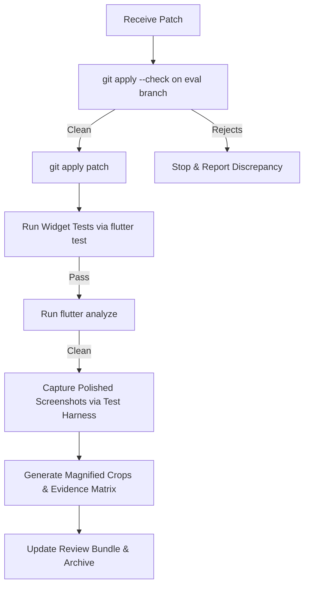

# ArmSphere — Repeatable Low-Credit Claude Sonnet UI/UX Review Workflow

This document establishes the official operational standard for using **Claude Sonnet 3.5 / 3.7 / Opus** as the dedicated visual UI/UX design reviewer while an automated pair agent (Antigravity) handles code integration, headless rendering, automated test verification, and Git lifecycle operations.

---

## 1. Core Operating Philosophy

1. **Strict Division of Labor**:
   - **Claude Sonnet**: Visual art director and ergonomic reviewer. Reviews rendered layout, contrast, hierarchy, typography, visual weight, and produces unified, production-ready `.patch` files.
   - **Antigravity (Integration Agent)**: Headless rendering, patch validation (`git apply --check`), test execution, static analysis (`flutter analyze`), disk space guard (`C:` drive protection, all caches on `E:\assets`), and Git history preservation.
   - **Human Owner**: High-level directional approval, no manual phone/emulator inspection required for component-level iterations.

2. **Low-Token / Low-Credit Optimization**:
   - **Zero Raw Repo Uploads**: Never paste or send full project archives.
   - **Targeted Slices**: Send only the focused screen file(s), relevant design token definitions, companion widget test, and real-pixel before screenshots.
   - **Batched Reviews**: Review an entire coherent screen or component family (e.g., complete dock + shell, or complete dashboard header + metrics cards) in a single exchange rather than micro-adjusting individual paddings across multiple prompts.

---

## 2. Screen Selection & Prioritization Matrix

Choose screens using the **"Surface-Area Impact"** hierarchy:

1. **Tier 1 — Core Persistent Shell & Primary Tabs**:
   - Navigation Dock & App Bar (`apps/mobile/lib/core/widgets/main_shell_screen.dart`) *(Completed)*
   - Athlete Dashboard / Arena (`apps/mobile/lib/features/athlete/screens/athlete_screens.dart`) *(Recommended Next)*
   - Discover Feed & Search (`apps/mobile/lib/features/home/screens/discover_screen.dart`)
2. **Tier 2 — Critical User Journeys**:
   - Events & Tournament Overview (`apps/mobile/lib/features/tournament/screens/tournament_screens.dart`)
   - Community Social Feed (`apps/mobile/lib/features/community/screens/community_feed_screen.dart`)
   - Athlete Passport / Profile (`apps/mobile/lib/features/athlete/screens/public_profile_screen.dart`)
3. **Tier 3 — Secondary & Operational Hubs**:
   - Referee Scorepad & Match Management (`apps/mobile/lib/features/referee/screens/`)
   - Settings & Account Management (`apps/mobile/lib/features/settings/screens/`)

---

## 3. Review Bundle Construction (Source & Visual Evidence)

When packaging a task bundle for Claude, create an archive under `E:\assets\claude_visual_reviews\task_<feature>_review_bundle.zip`.

### What to Include (Minimal Whitelist)
1. **Target UI Source**: Exactly the 1–3 Dart files containing the widgets being refined (e.g. `main_shell_screen.dart`).
2. **Design Tokens Reference**: `apps/mobile/lib/core/theme/app_theme.dart` (colors, typography constants, gradients, card radii).
3. **Relevant Unit/Widget Test**: Existing widget test file for the component (e.g. `main_shell_nav_dock_test.dart`).
4. **Before Screenshots**:
   - Standard phone viewport: 360 × 740 dp @ 2.0 DPR.
   - Modern tall viewport: 412 × 915 dp @ 2.0 DPR.
   - Accessibility test: 360 × 740 dp with 1.4× or 1.5× text scaling.
   - Magnified component crop (2× magnification of the specific element).
5. **Task Specification Readme (`PROMPT_BRIEF.md`)**:
   - Commit baseline SHA.
   - Specific design goals (e.g. Titanium Luxe consistency, WCAG AA 4.5:1 contrast, touch targets >= 48dp).
   - Invariant business logic to leave untouched.

### What to Strictly Exclude (Blacklist)
- `.git/` repository internals.
- Dependency caches (`.dart_tool/`, `build/`, `.gradle/`, `.pub-cache/`, `node_modules/`).
- Generated files (`*.g.dart`, `*.freezed.dart`, `GeneratedPluginRegistrant.java`).
- Platform wrappers (`android/`, `ios/`, `windows/`, `web/`, `linux/`, `macos/`).
- Secrets and keys (`.env`, `google-services.json`, keystores, private tokens).
- Unrelated feature modules and backend code.

---

## 4. Headless Visual Rendering Protocol (No Physical Device Needed)

Never require physical devices or slow emulators for component and screen review. Use Flutter's headless `WidgetTester` with dynamic real-font registration:

1. **Authentic Binary Font Loading**:
   Due to font-asset integrity constraints, load verified TrueType binaries (`SpaceGrotesk`, `MaterialIcons`) dynamically via `dart:ui.loadFontFromList` inside `tester.runAsync()`.
2. **RepaintBoundary Capture**:
   Wrap the root widget in a `RepaintBoundary(key: repaintKey)`.
3. **Capture Execution**:
   ```dart
   final boundary = repaintKey.currentContext!.findRenderObject() as RenderRepaintBoundary;
   final ui.Image image = await boundary.toImage(pixelRatio: 1.0);
   final byteData = await image.toByteData(format: ui.ImageByteFormat.png);
   file.writeAsBytesSync(byteData!.buffer.asUint8List());
   ```
4. **Multi-Viewport & Accessibility Matrix**:
   Always test nominal scale (1.0x) and accessibility scale (1.3x–1.5x) to detect text truncation (`...`) or `RenderFlex` overflow before handoff.

---

## 5. Contract for Claude's Output Patch

Claude must return **one unified, copy-pasteable Git diff or `.patch` file** formatted as follows:

```diff
diff --git a/apps/mobile/lib/path/to/screen.dart b/apps/mobile/lib/path/to/screen.dart
--- a/apps/mobile/lib/path/to/screen.dart
+++ b/apps/mobile/lib/path/to/screen.dart
...
```

### Review Response Requirements:
1. **Design Rationale**: Plain-text summary of visual changes (spacing, contrast ratios, token alignment).
2. **Safety & Invariant Statement**: Explicit confirmation that routes, riverpod providers, state machines, API calls, and business logic remain unaltered.
3. **Verification Test**: Companion test assertions added to the widget test covering the visual fix (e.g., verifying font size >= 10sp, scale factor capping, or contrast compliance).

---

## 6. Safe Integration & Verification Pipeline

When Claude provides a patch, execute the following strict checklist:



1. **Dry-Run Check**:
   `git apply --check <patch_file>` against the candidate commit.
2. **Isolated Branch Execution**:
   Apply only on an isolated feature/eval branch (e.g. `eval/<feature>-polish-sonnet`). Never apply directly to `main` or `design/titanium-luxe`.
3. **Automated Verification Suite**:
   ```powershell
   $env:PUB_CACHE="E:\assets\.pub-cache"
   $env:TEMP="E:\assets\temp"
   $env:TMP="E:\assets\temp"
   E:\flutter\bin\flutter.bat test test/path/to/widget_test.dart
   E:\flutter\bin\flutter.bat analyze lib/path/to/modified_files.dart
   ```
4. **Visual Proof Generation**:
   Re-run the capture harness with `$env:CAPTURE_PREFIX="polished"` to generate direct side-by-side comparison images.

---

## 7. Protection of Sensitive Architecture & Business Logic

UI polish must never compromise the platform's core operational integrity:
- **Authentication & MFA**: Never alter biometric/MFA gating, token refreshing, or secure storage routines.
- **Role Permissions**: Never change `app_router.dart` permission checks (`_canAccessReferee`, `_canAccessGovernance`).
- **Payment & Stripe Integration**: Never modify amount calculations, payment method intents, or webhook handlers.
- **Tournament Rules & Brackets**: Match scoring, referee scorepad logic, and tournament advancement logic must remain 100% untouched during styling updates.

---

## 8. Compact Project Handoff Standard (Session Continuity)

To start a new conversation without token bloat or context overflow:
1. Provide the current **Branch Name** and **HEAD commit SHA**.
2. Provide the path to the **active review bundle zip** (e.g. `E:\assets\claude_visual_reviews\task_nav_dock_visual_bundle_real_fonts.zip`).
3. State the exact target screen family and primary design objective.
4. Antigravity can immediately inspect the pre-rendered artifacts and resume without rebuilding dependencies or re-scanning the entire repository.
